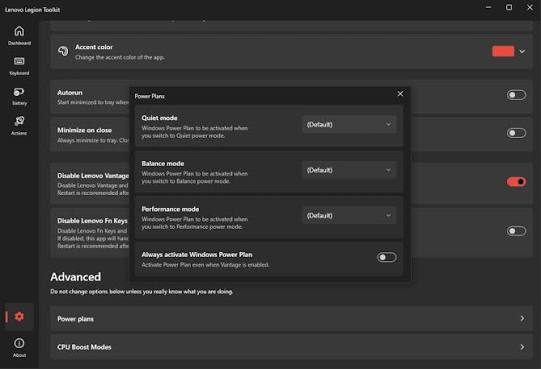
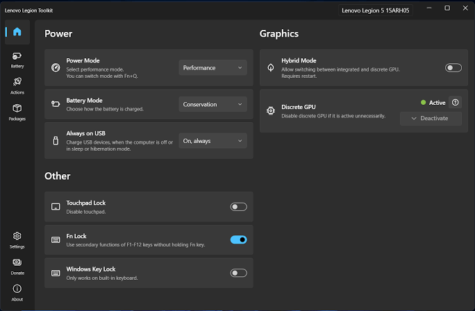

# Lenovo Legion Toolkit for Everyday Laptop Control

Lenovo Legion Toolkit brings power, charging, graphics, and keyboard controls into one Windows application.
Legion Toolkit also connects these settings to Quick Actions and events such as attaching an AC adapter.
Available controls depend on the laptop, firmware, and supported hardware interfaces.

[](https://legion-toolkit.github.io/Legion-Toolkit/)

## Normal Usage

A desk session and a battery session often need different combinations of settings.
Choose the intended power behavior first, then review charging, graphics, and keyboard lighting.
Save repeated changes as an action instead of adjusting each control during every transition.

| Session decision | At a desk | Away from AC power |
| --- | --- | --- |
| Power behavior | Select a mode appropriate for the workload | Start with Quiet or Balance |
| Charging | Consider Conservation mode for extended AC use | Review the charge needed for the next trip |
| Graphics | Account for displays connected to the discrete GPU | Check whether the discrete GPU is still active |
| Keyboard | Choose a readable lighting level | Reduce lighting when practical |

Conservation mode uses a threshold provided by firmware.
An arbitrary percentage slider should not be assumed from the phrase battery charge limit.
Rapid charging is a separate option where the device supports it.



## Features

The application combines hardware settings with event-driven actions and status information.
Its dashboard can expose battery statistics, discrete GPU activity, and supported laptop controls.

- Switch the Legion power mode.
- Review battery charging behavior.
- Adjust supported display and keyboard options.
- Group recurring changes into Quick Actions.
- Use the on-screen display to follow system readings during a workload.

### Custom Mode

The legion toolkit fan control workflow centers on Custom Mode on supported hardware.
Quiet, Balance, and Performance retain their firmware-defined fan behavior.
Custom Mode can expose fan and power settings, with the available controls varying by device.

For legion toolkit custom mode, begin with a repeatable workload and an appropriate AC adapter.
Change one setting at a time so that its effect on noise and sustained performance is clear.

1. Select Custom from the power mode selector.
2. Review which fan and power controls the device actually exposes.
3. Make a small adjustment within the available range.
4. Observe the same workload before changing another setting.

Fn+Q does not select Custom Mode.
A missing control can reflect a firmware or model limitation rather than an application preference.

### Windows Power Plans & Windows Power Mode

Legion power modes and Windows power settings control different parts of the system.
A Legion mode can be associated with a Windows power mode in application settings.

Keep the association understandable for the way the laptop is used.
For example, a quiet office routine and a sustained rendering routine need different priorities.
Avoid mixing several automatic switching rules before their individual behavior is clear.

### CLI

The native command-line executable is named `llt.exe`.
The application must be running in the background with CLI access enabled.
The example assumes `llt` is available on PATH and a Quick Action named Desk session already exists.

```powershell
$actionName = 'Desk session'
llt quickAction --list
llt quickAction $actionName
```

The first command lists saved Quick Actions; the second invokes the chosen action.
It does not create an action or infer which power and charging settings should belong to it.

Command definitions are in [Program.cs](LenovoLegionToolkit.CLI/Program.cs).
[IpcClient.cs](LenovoLegionToolkit.CLI/IpcClient.cs) sends requests to the running application.
[LenovoLegionToolkit.CLI.csproj](LenovoLegionToolkit.CLI/LenovoLegionToolkit.CLI.csproj) declares the executable assembly name.

The message contract separates an operation, a name, and an optional value in [IpcRequest.cs](LenovoLegionToolkit.CLI.Lib/IpcRequest.cs).
A response reports success and an optional message through [IpcResponse.cs](LenovoLegionToolkit.CLI.Lib/IpcResponse.cs).
Connection failures have a dedicated type in [IpcConnectException.cs](LenovoLegionToolkit.CLI.Lib/IpcConnectException.cs).

### Running programs or scripts from actions

An Actions Run step can start an executable with arguments.
This makes it possible to combine laptop settings with a small session-specific helper.

For a power-mode-change trigger, the following Windows PowerShell script produces a short reminder.
Use `powershell.exe` as the executable and `-NoProfile -File "C:\Scripts\LegionModeNote.ps1"` as arguments.
The script path is an example chosen by the user, not a file included in this repository.

```powershell
switch ($env:LLT_POWER_MODE_NAME) {
    'QUIET' { 'Quiet session: prioritize light tasks and low noise.' }
    'PERFORMANCE' { 'Performance session: keep the appropriate AC adapter connected.' }
    'CUSTOM' { 'Custom session: review the active fan and power settings.' }
    default { 'Review the current Legion power mode before starting work.' }
}
```

Enable Wait for exit, then use `$RUN_OUTPUT$` in a Show notification step.
The helper returns text; the action's own setting steps determine the laptop configuration.

#### Environment

Trigger context is supplied through environment variables.
`LLT_POWER_MODE_NAME` belongs to a power-mode-change event.
AC connection events provide `LLT_IS_AC_ADAPTER_CONNECTED` instead.
A script should only rely on variables supplied by its selected trigger.

The CLI transport uses message-mode pipes and JSON serialization in [PipeStreamExtensions.cs](LenovoLegionToolkit.CLI.Lib/Extensions/PipeStreamExtensions.cs).
Its shared project references are declared in [LenovoLegionToolkit.CLI.Lib.csproj](LenovoLegionToolkit.CLI.Lib/LenovoLegionToolkit.CLI.Lib.csproj).

### Hybrid Mode and GPU Working Modes

Hybrid graphics and Advanced Optimus are separate mechanisms.
Changing between the principal Hybrid and discrete-only modes requires a restart.

A connected external display or a process using the discrete GPU can prevent it from disconnecting.
Check the activity information before expecting the GPU to power down.
Additional Hybrid modes are available only on supported models.

### Keyboard & Lighting

Lighting support includes Spectrum, four-zone RGB, and white backlights where the hardware provides them.
The application does not support keyboards that require Corsair iCue.
Choose one application to manage a lighting device when overlapping controls cause conflicts.



The supplied macro module also contains input recording and playback components.
[MacroController.cs](LenovoLegionToolkit.Lib.Macro/MacroController.cs) coordinates those components.
[MacroRecorder.cs](LenovoLegionToolkit.Lib.Macro/Utils/MacroRecorder.cs) records input events.
[MacroPlayer.cs](LenovoLegionToolkit.Lib.Macro/Utils/MacroPlayer.cs) implements playback.
[MacroSettings.cs](LenovoLegionToolkit.Lib.Macro/Utils/MacroSettings.cs) holds the enabled state and saved sequences.

Event data includes source, direction, key, position, and delay in [Structs.cs](LenovoLegionToolkit.Lib.Macro/Structs.cs).
The corresponding categories and recorder flags appear in [Enums.cs](LenovoLegionToolkit.Lib.Macro/Enums.cs).
[MacroIdentifierTypeConverter.cs](LenovoLegionToolkit.Lib.Macro/Utils/TypeConverters/MacroIdentifierTypeConverter.cs) converts identifiers to and from strings.
Dependency registration is in [IoCModule.cs](LenovoLegionToolkit.Lib.Macro/IoCModule.cs).
The module's project definition is [LenovoLegionToolkit.Lib.Macro.csproj](LenovoLegionToolkit.Lib.Macro/LenovoLegionToolkit.Lib.Macro.csproj).

### RGB and lighting

Available lighting controls can change with the keyboard model and BIOS.
Some devices expose fewer options than others, even within the same laptop generation.
Treat a screenshot as an example of one machine's capabilities.

## Compatibility

This is a Windows utility for supported Lenovo gaming hardware.
The community project is independent of Lenovo.
Support for one Legion model does not establish identical support for every LOQ or IdeaPad Gaming model.

### Lenovo's software

Vantage, Hotkeys, and Legion Zone can overlap with controls managed by the application.
The built-in disable options can help avoid competing background behavior.
Review which application should own a setting before adding an automatic action for it.

## Localization

Macro interface text is stored in [Resource.resx](LenovoLegionToolkit.Lib.Macro/Resources/Resource.resx).
The Russian translation is in [Resource.ru.resx](LenovoLegionToolkit.Lib.Macro/Resources/Resource.ru.resx).
[Resource.Designer.cs](LenovoLegionToolkit.Lib.Macro/Resources/Resource.Designer.cs) provides generated resource accessors.
Translation path mapping is recorded in [crowdin.yml](crowdin.yml).

Preserve resource identifiers when reviewing a translation.
A translated label should continue to describe the same action or recording option.

## Contribution

This source selection includes the CLI, shared messaging, macro module, and probe project.
It does not include the complete main application library or desktop interface.
The solution therefore should not be described as a complete buildable checkout.

[Directory.Build.props](Directory.Build.props) records shared framework, platform, and version properties.
[LenovoLegionToolkit.sln](LenovoLegionToolkit.sln) records the solution's project organization.

When comparing lenovo legion toolkit releases, read the community project's release notes for model-specific changes.
Report the laptop model, BIOS version, expected behavior, and the action that reproduces an issue.
Separate an unavailable firmware feature from a failure in a control that previously worked.

## Related Search Terms

Lenovo Legion Toolkit, Legion Toolkit, legion toolkit fan control, legion toolkit custom mode, lenovo legion toolkit releases, lenovo, lenovo-legion, legion, windows, hardware-control, hardware-monitoring, fan-control, conservation-mode, performance-tuning, gaming-laptop
